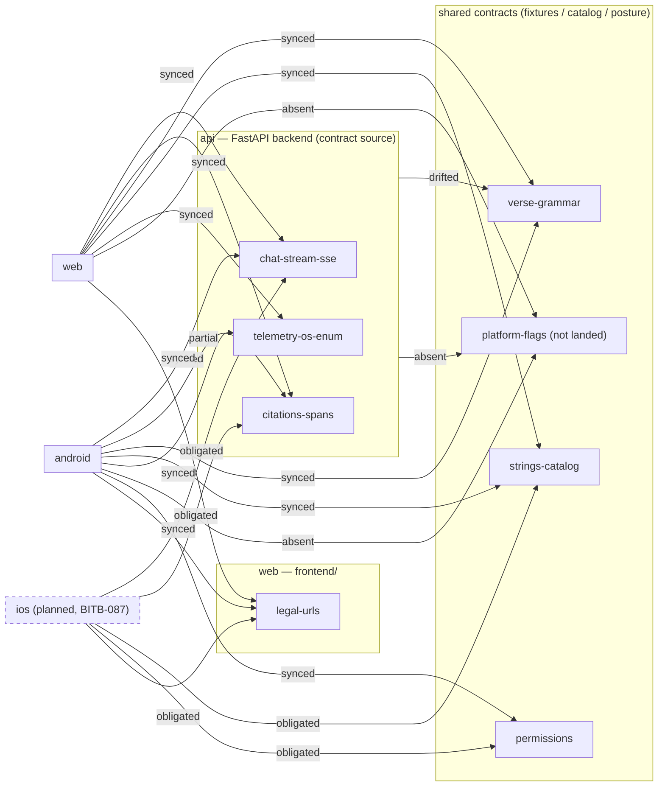

# Cross-Client Parity Landscape

> Generated from [`docs/parity/registry.yaml`](registry.yaml) (BITB-262, updated 2026-11-08) by `tools/parity-graph/render.py` — do not edit; regenerate.

35 capabilities (2 negative obligations) × 4 clients. Evidence for every cell lives in the registry; this page is the view.

## Status legend

- 🟢 **synced** — implemented, at parity with the reference behavior.
- 🔴 **drifted** — implementations diverged; a story tracks the gap.
- 🟡 **partial** — exists, open follow-ups remain.
- ⚫ **absent** — not implemented on this client (or nowhere yet).
- 🔵 **obligated** — a planned client's spec requires it (BITB-087).
- ⚪ **n/a** — does not apply to this client.

## Container diagram

Contracts live in the box that owns their source of truth; client boxes connect with their consumption status. `ios` is planned (BITB-087) — dashed.

## Contracts

| Contract | Source of truth | api | web | android | ios |
|---|---|---|---|---|---|
| `chat-stream-sse` | `api/chat/service.py`, `docs/parity/openapi.json`, `BITB-086` | 🟢 synced | 🟢 synced | 🟢 synced | 🔵 obligated (BITB-087) |
| `citations-spans` | `api/utils/verse_parser.py`, `api/chat/service.py:2135-2141`, `docs/DONE/BITB-086-server-emitted-citation-spans.md` | 🟢 synced | 🟢 synced (BITB-109) | 🟡 partial | 🔵 obligated (BITB-087) |
| `verse-grammar` | `tests/fixtures/verse_grammar.json`, `scripts/generate_localized_book_map.py` | 🔴 drifted (BITB-267) | 🟢 synced | 🟢 synced | ⚪ n/a |
| `strings-catalog` | `android/app/src/main/res/values/strings.xml`, `.github/workflows/android-ci.yml`, `frontend/src/test/translations.test.ts` | — | 🟢 synced | 🟢 synced | 🔵 obligated (BITB-087) |
| `telemetry-os-enum` | `api/main.py:567`, `docs/DONE/BITB-247-tts-start-failed-telemetry.md` | — | 🟢 synced | 🟢 synced | ⚪ n/a |
| `platform-flags` | `docs/BACKLOG_STORIES/BITB-242-platform-selective-feature-flags.md` | ⚫ absent | ⚫ absent | ⚫ absent | ⚪ n/a |
| `permissions` | `android/app/src/main/AndroidManifest.xml:5-6`, `docs/BACKLOG_STORIES/BITB-087-ios-app-v1-chat-parity.md` | — | ⚪ n/a | 🟢 synced | 🔵 obligated (BITB-087) |
| `legal-urls` | `frontend/src/app/[locale]/privacy/page.tsx`, `frontend/src/app/[locale]/terms/page.tsx`, `android/app/src/main/kotlin/org/voxquieta/app/utils/LegalUrls.kt` | — | 🟢 synced | 🟢 synced | 🔵 obligated (BITB-087) |

## Capability × client status matrix

| Capability | api | web | android | ios |
|---|---|---|---|---|
| **Streaming chat over SSE (request fields + metadata/content/completion events)** `chat-streaming` | ⚪ n/a | 🟢 synced | 🟢 synced | 🔵 obligated (BITB-087) |
| **Thumbs up/down feedback with optional comment** `message-feedback` | 🟢 synced | 🟢 synced | 🟢 synced | 🔵 obligated (BITB-087) |
| **Feedback rethink window + maintainer-sharing notice (BITB-042)** `feedback-rethink` | ⚪ n/a | 🟢 synced (BITB-042) | 🟢 synced (BITB-042) | 🔵 obligated (BITB-087) |
| **Markdown rendering of assistant answers** `markdown-rendering` | ⚪ n/a | 🟢 synced | 🟢 synced | ⚪ n/a |
| **Tappable verse references inside the message body** `inline-verse-links` | ⚪ n/a | 🟢 synced | 🟢 synced | 🔵 obligated (BITB-087) |
| **Verse-reference detection in free text (the three parsers)** `verse-reference-detection` | 🔴 drifted (BITB-267) | 🟢 synced | 🟢 synced | 🔵 obligated (BITB-087) |
| **Verses panel with Referenced / All-Related filter** `verses-panel` | ⚪ n/a | 🟢 synced | 🟢 synced | 🔵 obligated (BITB-087) |
| **Chapter reading view** `chapter-reading` | 🟢 synced | 🟢 synced | 🟢 synced | 🔵 obligated (BITB-087) |
| **Conversation history, offline-readable** `conversation-history` | ⚪ n/a | 🟢 synced | 🟢 synced | 🔵 obligated (BITB-087) |
| **Session message limit with friendly "take a break"** `session-message-limit` | 🟢 synced | 🟢 synced | 🟢 synced | 🔵 obligated (BITB-087) |
| **Turnstile token attachment + single-use + 403 retry-once** `turnstile-attestation` | 🟢 synced | 🟢 synced | 🟢 synced | 🔵 obligated (BITB-087) |
| **Backend cold-start / warm-up UX** `backend-warmup-ux` | 🟢 synced | 🟢 synced | 🟢 synced | ⚪ n/a |
| **Scroll-to-bottom affordance during streaming** `scroll-to-bottom` | ⚪ n/a | 🟢 synced | 🟢 synced | ⚪ n/a |
| **Share an assistant answer (system share / copy)** `share-message` | ⚪ n/a | 🟢 synced | 🟢 synced | ⚪ n/a |
| **Read the answer aloud (Listen button)** `read-aloud` | ⚪ n/a | 🟡 partial (BITB-251) | 🟡 partial (BITB-252) | 🔵 obligated (BITB-119) |
| **UI language picker across 11 locales** `ui-language-picker` | ⚪ n/a | 🟢 synced | 🟢 synced | 🔵 obligated (BITB-087) |
| **Bible translation picker** `translation-picker` | 🟢 synced | 🟢 synced | 🟢 synced | 🔵 obligated (BITB-087) |
| **Light/dark theme toggle** `theme-toggle` | ⚪ n/a | ⚫ absent | 🟢 synced | 🔵 obligated (BITB-087) |
| **Settings with Privacy / Terms / About links** `settings-legal-links` | ⚪ n/a | 🟢 synced | 🟢 synced | 🔵 obligated (BITB-087) |
| **Offline / no-network handling** `offline-handling` | ⚪ n/a | 🟢 synced | 🟢 synced | 🔵 obligated (BITB-087) |
| **Splash / first-paint experience** `splash` | ⚪ n/a | 🟢 synced | 🟢 synced | 🔵 obligated (BITB-087) |
| **Crisis resources card on self-harm turns** `crisis-resources-card` | 🟢 synced (BITB-255) | 🟢 synced (BITB-255) | 🟢 synced (BITB-255) | ⚪ n/a |
| **Suggested follow-up question chips** `follow-up-suggestions` | 🟢 synced | 🟢 synced | 🟢 synced | ⚪ n/a |
| **Church finder** `church-finder` | 🟢 synced | 🟢 synced | 🟢 synced | ⚪ n/a |
| **Contact form** `contact-form` | 🟢 synced | 🟢 synced | 🟢 synced | ⚪ n/a |
| **In-app changelog** `in-app-changelog` | ⚪ n/a | 🟢 synced | 🟢 synced | ⚪ n/a |
| **"What's New" spotlight sheet** `whats-new-sheet` | ⚪ n/a | 🟢 synced | 🟢 synced | ⚪ n/a |
| **About / intro sheet** `about-intro` | ⚪ n/a | 🟢 synced | 🟢 synced | ⚪ n/a |
| **Language-mismatch switch banner** `language-mismatch-banner` | 🟢 synced | 🟢 synced | 🟢 synced | ⚪ n/a |
| **Diagnostic report export** `diagnostic-report` | ⚪ n/a | ⚫ absent | 🟢 synced | ⚪ n/a |
| **App install landing page** `app-install-cta` | ⚪ n/a | 🟢 synced | ⚪ n/a | ⚪ n/a |
| **PWA installability (service worker + shell)** `pwa-installability` | ⚪ n/a | 🟢 synced | ⚪ n/a | ⚪ n/a |
| **Ask by voice (speech input)** `ask-by-voice` | ⚪ n/a | ⚫ absent (BITB-120) | ⚫ absent (BITB-120) | ⚪ n/a |
| **iOS ships NO verse-reference regex** *(negative obligation)* `ios-no-verse-regex` | ⚪ n/a | ⚪ n/a | ⚪ n/a | 🔵 obligated (BITB-087) |
| **iOS ships NO donate entry point** *(negative obligation)* `ios-no-donate-entry` | ⚪ n/a | ⚪ n/a | ⚪ n/a | 🔵 obligated (BITB-087) |

## Drift watch

The rows below are the registry's payload, not CI failures — each stays visible until its story closes. Drifted rows are the loudest; partial and absent are the backlog's shape.

## Drifted (1)

- 🔴 **`verse-reference-detection`** · api — **BITB-267**
  - The whitelist lookbehind misses citations after `**`, `—` or `¿` that web/Android catch; missed backend references mean no lookup, passage context or grounding (BITB-267, Todo).
  - evidence: `api/utils/verse_parser.py:351`
  - evidence: `docs/BACKLOG_STORIES/BITB-267-backend-boundary-bold-dash-inverted-question.md`

## Partial (2)

- 🟡 **`read-aloud`** · android — **BITB-252**
  - Shipped; the TTS-never-starts/stays-on-pause defect is open (BITB-252).
  - evidence: `android/app/src/main/kotlin/org/voxquieta/app/tts/SpeechEngine.kt`
  - evidence: `android/app/src/main/kotlin/org/voxquieta/app/tts/SpeakableText.kt`
- 🟡 **`read-aloud`** · web — **BITB-251**
  - Shipped (PR #1132 review round) with the telemetry funnel (BITB-247); fallback-voice choice remains open (BITB-251).
  - evidence: `frontend/src/components/ListenButton.tsx`
  - evidence: `frontend/src/components/ChatMessage.listen.test.tsx`

## Absent (4)

- ⚫ **`ask-by-voice`** · android — **BITB-120**
  - Planned for Android (BITB-120, Todo); no RecognizerIntent/RECORD_AUDIO in the app.
- ⚫ **`ask-by-voice`** · web — **BITB-120**
  - Planned for web (BITB-120, Todo); the web's current voice UI is read-aloud OUTPUT.
- ⚫ **`diagnostic-report`** · web
  - No web diagnostic export exists (browser devtools are the web's equivalent).
- ⚫ **`theme-toggle`** · web
  - The web ships a single light theme — no dark mode and no in-app toggle.

## Status rollup

| Status | Cells |
|---|---|
| 🟢 synced | 69 |
| 🔴 drifted | 1 |
| 🟡 partial | 2 |
| ⚫ absent | 4 |
| 🔵 obligated | 19 |
| ⚪ n/a | 45 |

---

Regenerate with `python tools/parity-graph/render.py` (or `make parity-registry-check` to freshness-check). Part of the cross-client parity knowledge graph (BITB-260 stage 2).
